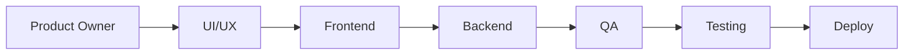
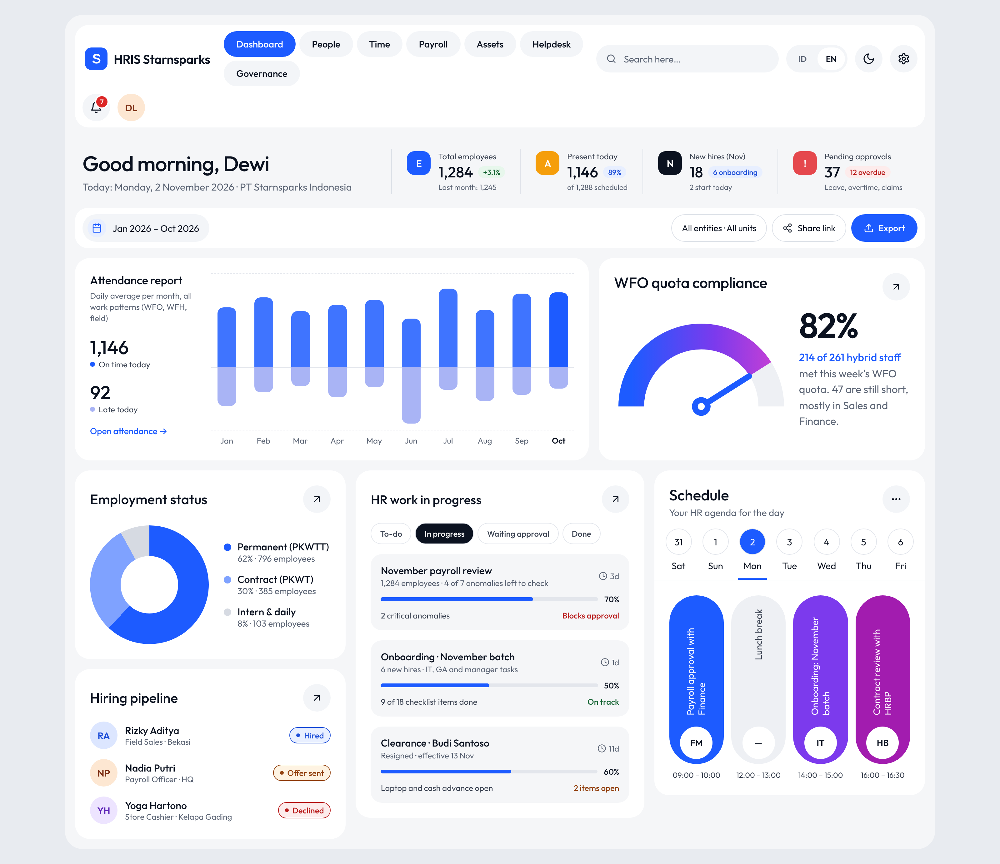
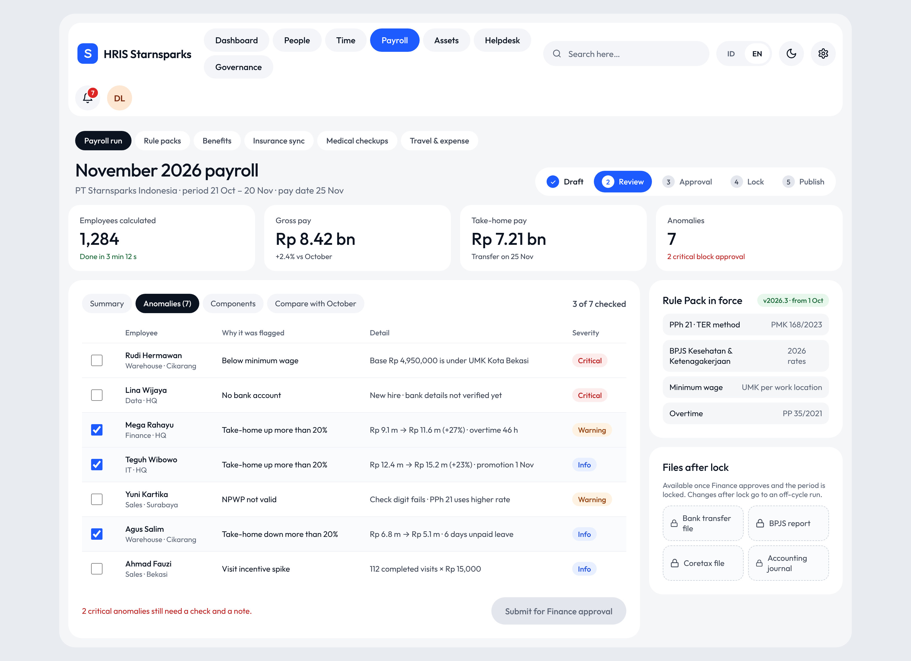
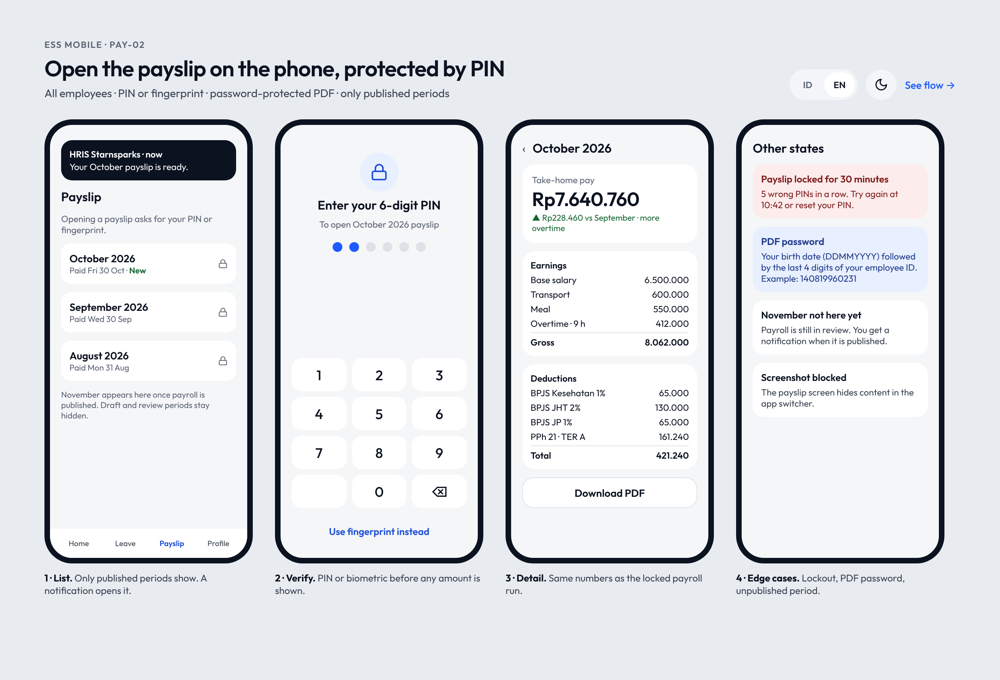
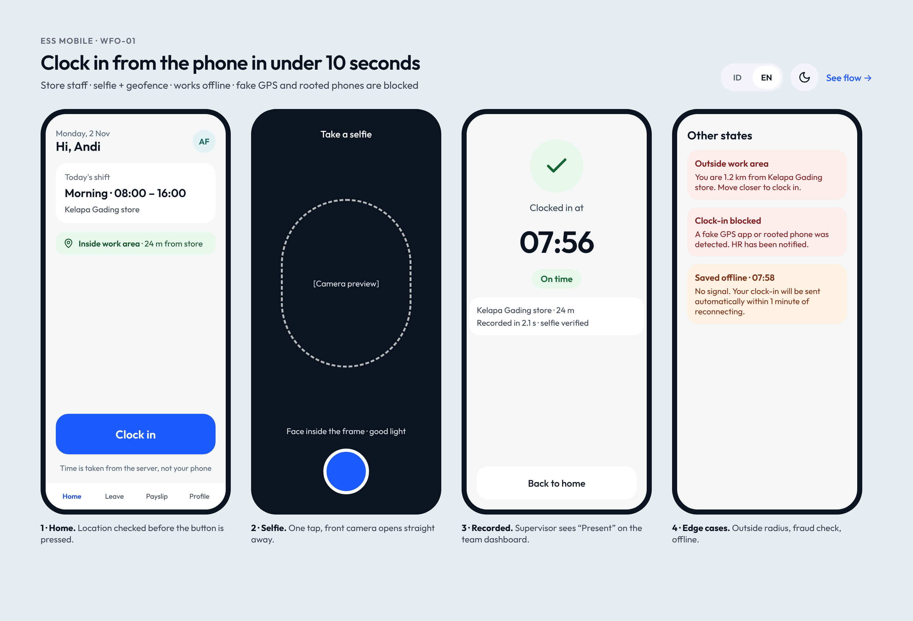
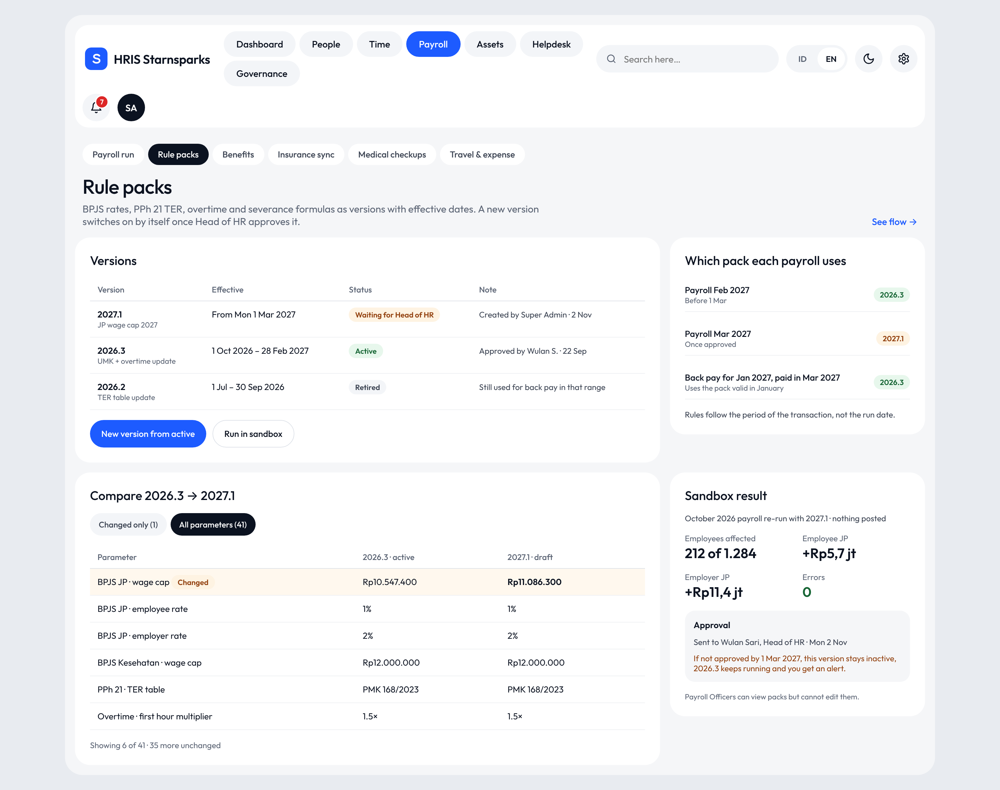
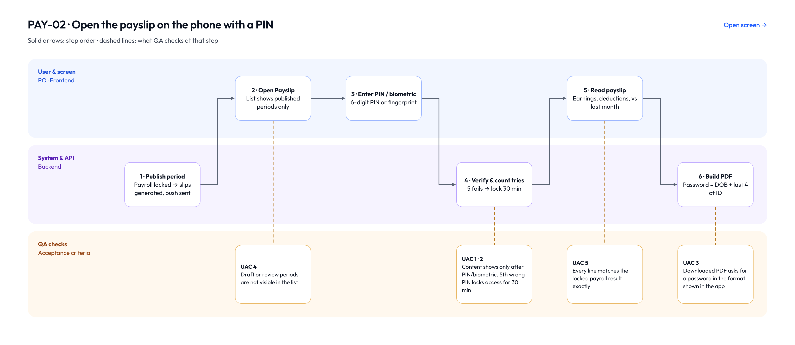

[English](README.md) · **Bahasa Indonesia**

# HRIS Starnsparks: studi kasus produk

Saya Ares Suhendar, Product Owner di Jakarta. Repo ini menceritakan bagaimana saya menyusun cakupan dan menjalankan backlog HRIS Starnsparks, sistem HR untuk perusahaan menengah di Indonesia yang punya karyawan kantor, kru toko, dan pekerja pabrik sekaligus.

Proyek ini masih berjalan, belum rilis. Yang saya bagikan adalah sisi produknya: masalahnya, keputusan cakupan, backlog, dan trade-off yang saya ambil.

## Masalahnya

Perusahaan yang jadi sasaran sistem ini biasanya menjalankan HR dengan tiga atau empat aplikasi plus banyak spreadsheet. Absensi di satu aplikasi, payroll di Excel, kontrak di folder bersama, serah terima aset masih di kertas. Masalahnya muncul di tempat yang sama setiap bulan:

- Payroll harus dicek manual karena absensi, lembur, dan klaim datang dari sumber berbeda.
- Kontrak PKWT habis tanpa ada yang sadar, padahal ini risiko hukum sesuai PP 35/2021.
- Karyawan toko dan lapangan tidak bisa sekadar cek sisa cuti atau buka slip gaji tanpa bertanya ke HR.
- Tidak ada yang bisa memastikan siapa saja yang sudah melihat data gaji atau data medis, padahal UU PDP sudah berlaku.

## Yang saya rancang

Satu sistem, lima pilar, 16 modul:

| Pilar | Modul |
|---|---|
| Operasional inti & tata kelola | Organisasi & rekrutmen, operasional karyawan, payroll, tata kelola & keamanan |
| Kontrol tenaga kerja & aset | Aset, penjadwalan shift, dinas & biaya |
| Talenta & kinerja | Kinerja, pembelajaran, engagement |
| Siklus karyawan & layanan HR | Kontrak, offboarding, benefit & kesehatan, helpdesk HR, pusat kebijakan |
| Analitik | People analytics dan dasbor eksekutif |

Saya menulis PRD dulu, lalu memecahnya di Plane menjadi 16 modul dan 93 work item.

## Cara saya menjalankan backlog

Setiap user story punya empat bagian yang sama: story, deskripsi singkat, user journey langkah demi langkah, dan acceptance criteria dalam format Diberikan / Ketika / Maka. Bagian terakhir ini wajib. Kalau QA tidak bisa mengujinya, story belum siap.

Satu story adalah satu kartu yang berpindah dari tim ke tim, bukan disalin ke board terpisah:

Begitu satu tim selesai, kartunya masuk ke To-do tim berikutnya. Serah terima jadi terlihat jelas dan tidak ada lagi "saya kira kamu yang pegang".

Seluruh pembangunan dipadatkan ke roadmap satu bulan, jadi pekerjaan desain saya bagi per prioritas:

1. **Urgent:** design system, absen dari HP, cuti, impor massal, pola kerja hybrid, permintaan data pribadi, peran dan akses, restrukturisasi organisasi.
2. **High:** slip gaji dengan PIN, klaim dengan foto nota, rule pack, templat kontrak, tanda tangan elektronik dengan e-Meterai, alur resign, analisis exit interview, permintaan tenaga kerja.
3. **Medium:** dinas, tukar shift, anggaran lembur, serah terima dan peminjaman aset, sinkron asuransi, MCU, dasbor layanan HR, pencarian kebijakan.

Hasilnya sekitar 40 layar, masing-masing dengan diagram alur tiga jalur (pengguna dan layar, sistem dan API, pengecekan QA) supaya PO, frontend, backend, dan QA membaca halaman yang sama.

## Beberapa layarnya

Dasbor HR. Yang pertama dilihat HR di pagi hari: kehadiran, persetujuan yang menunggu, dan pekerjaan yang macet.

Review payroll. Payroll tidak bisa dikirim ke Finance selama anomali kritis belum dicek, dan rule pack yang berlaku tampil di samping angkanya.

Slip gaji di HP. PIN atau sidik jari sebelum angka apa pun muncul, dan kasus-kasus pinggir dirancang dari awal, bukan ditemukan QA belakangan.

Absen untuk karyawan toko. Selfie plus geofence, tetap jalan saat offline, memblokir fake GPS.

Rule pack. Aturan berversi dengan tanggal berlaku, uji coba di sandbox, dan persetujuan Head of HR.

Dan alur di balik story slip gaji. Setiap langkah terhubung ke acceptance criteria yang akan dicek QA.

*Screenshot memakai tampilan bahasa Inggris; aplikasinya default Bahasa Indonesia.*

## Keputusan yang perlu dijelaskan

**Aturan disimpan sebagai data, bukan kode.** Tarif BPJS, tabel TER PPh 21, pengali lembur, dan batas PKWT bisa berubah. Saya minta semuanya disimpan sebagai "rule pack" berversi dengan tanggal berlaku. Payroll Februari tetap memakai aturan Februari walaupun diproses ulang di bulan Maret. Rule pack baru harus disetujui Head of HR dan bisa diuji dulu di sandbox.

**Mobile dulu untuk karyawan yang tidak duduk di meja.** Karyawan toko dan pabrik adalah kelompok terbesar sekaligus yang paling jarang dilayani. Absen, cuti, slip gaji, dan klaim dirancang untuk HP lebih dulu. Absen tetap bisa saat offline dan memblokir fake GPS. Versi web untuk HR dan atasan.

**Data medis tetap di dokter.** Untuk MCU, HR hanya melihat status kelayakan kerja (layak, layak dengan catatan, tidak layak). Detailnya tetap di dokter perusahaan dan setiap akses tercatat. Fitur ini tidak bisa diaktifkan sebelum DPIA disetujui.

**Kelompok kecil disembunyikan.** Hasil exit interview per atasan disamarkan kalau jawabannya kurang dari lima, supaya tidak ada yang bisa menebak siapa menjawab apa.

**Paklaring tidak pernah ditahan.** Surat keterangan kerja terbit di hari terakhir walaupun masih ada item clearance terbuka. Item terbuka hanya memengaruhi hak akhir. Menahan paklaring karena barang belum dikembalikan masih sering terjadi, dan saya tidak mau sistem ini mempermudahnya.

**Bahasa Indonesia sebagai default.** Sebagian besar pengguna lebih nyaman dengan Bahasa Indonesia, jadi itu bawaannya, dan English tinggal satu ketuk. Teks hukum seperti peraturan perusahaan dan kontrak tetap berbahasa Indonesia di kedua mode.

## Contoh story

Dua story dari backlog, persis seperti yang ditulis untuk tim, ada di [docs/sample-stories.md](docs/sample-stories.md).

## Status saat ini

- PRD dan backlog: selesai
- UI/UX untuk semua story yang direncanakan: selesai, sedang direview
- Usability test dengan lima karyawan lapangan di staging: direncanakan
- Pembangunan: sedang berjalan

File desain tersedia jika diminta.

## Alat yang dipakai

Plane untuk backlog dan board tim, design canvas untuk layar dan alur, Mermaid untuk diagram.

---

Ares Suhendar · [LinkedIn](https://www.linkedin.com/in/ares-suhendar-606104138/)
