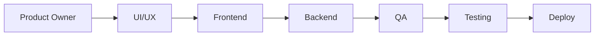

**English** · [Bahasa Indonesia](README.id.md)

# HRIS Starnsparks: product case study

I'm Ares Suhendar, a Product Owner based in Jakarta. This repo walks through how I scoped and ran the backlog for HRIS Starnsparks, an HR system for mid-size Indonesian companies with office staff, store crews and factory workers under one roof.

It's a working project, not a finished launch. I'm sharing the product side: the problem, the scope calls, the backlog, and the trade-offs I made along the way.

## The problem

The companies this is built for usually run HR on three or four tools plus a lot of spreadsheets. Attendance lived in one app, payroll in Excel, contracts in a shared folder, and asset handover on paper. The pain showed up in the same places every month:

- Payroll had to be checked by hand because attendance, overtime and claims came from different sources.
- PKWT (fixed-term) contracts expired without anyone noticing, which is a legal risk under PP 35/2021.
- Field and store staff couldn't do simple things like check their leave balance or open a payslip without asking HR.
- Nobody could say for sure who had seen salary or medical data, which matters now that UU PDP is in force.

## What I set out to build

One system, five pillars, 16 modules:

| Pillar | Modules |
|---|---|
| Core operations & governance | Org & hiring, workforce operations, payroll, governance & security |
| Workforce & asset control | Assets, rostering, travel & expense |
| Talent & performance | Performance, learning, engagement |
| Lifecycle & HR support | Contracts, offboarding, benefits & health, HR helpdesk, policy center |
| Analytics | People analytics and executive dashboards |

I wrote the PRD first, then broke it down in Plane into 16 modules and 93 work items.

## How I ran the backlog

Every user story uses the same four parts: the story, a short description, the user journey step by step, and acceptance criteria written as Given / When / Then. That last part was non-negotiable. If QA can't test it, it isn't ready.

Each story is one card that moves from team to team instead of being copied into separate boards:

When a team finishes, the card lands in the next team's To-do. It made handoffs visible and stopped the "I thought you had it" problem.

The whole build was squeezed into a one-month roadmap, so I split the design work into priority batches:

1. **Urgent:** design system, mobile clock-in, leave, bulk import, hybrid work patterns, data privacy requests, roles and access, org restructure.
2. **High:** payslip with PIN, claims with receipt photo, rule packs, contract templates, e-sign with e-Meterai, resignation flow, exit interview analysis, manpower requests.
3. **Medium:** business trips, shift swap, overtime budget, asset handover and loans, insurance sync, medical checkups, HR service dashboard, policy search.

About 40 screens came out of that, each with a flow diagram split into three lanes (user and screen, system and API, QA checks) so PO, frontend, backend and QA could read the same page.

## Decisions worth explaining

**Rules live in data, not code.** BPJS rates, PPh 21 TER tables, overtime multipliers and PKWT limits change. I asked for them to be stored as versioned "rule packs" with an effective date. Payroll for February uses February's rules even if it's re-run in March. A new pack needs Head of HR approval and can be tested in a sandbox first.

**Mobile first for people who don't sit at a desk.** Store and factory staff are the biggest group and the least served. Clock-in, leave, payslip and claims are designed for a phone first. Clock-in works offline and blocks fake GPS. The web app is for HR and managers.

**Medical data stays with the doctor.** For medical checkups, HR only ever sees a fitness status (fit, fit with notes, unfit). Details stay with the company doctor and every view is logged. The feature can't be switched on until a DPIA is approved.

**Small groups get hidden.** Exit interview results by manager are masked when there are fewer than five answers, so nobody can guess who said what.

**Paklaring is never held back.** The reference letter is issued on the last day even if clearance items are still open. Open items only affect final pay. Holding the letter back over unreturned items happens a lot, and I didn't want the system to make it easy.

**Indonesian by default.** Most users are more comfortable in Bahasa Indonesia, so it's the default, with English one tap away. Legal text like company regulations and contracts stays in Indonesian in both modes.

## Sample stories

Two stories from the backlog, as written for the team, are in [docs/sample-stories.md](docs/sample-stories.md). The backlog itself is in Indonesian because that's what the team works in.

## Where it stands

- PRD and backlog: done
- UI/UX for all planned stories: done, in review
- Usability test with five field employees on staging: planned
- Build: in progress

Design files are available on request.

## Tools

Plane for the backlog and team boards, a design canvas for screens and flows, Mermaid for diagrams.

---

Ares Suhendar · [LinkedIn](https://www.linkedin.com/in/ares-suhendar-606104138/)
